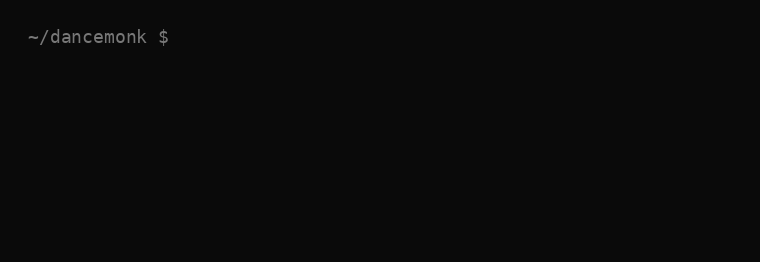

  

  
  
  

---

### `$ whoami`

Hey, I'm Vlad. Security+ and CCNA certified, working toward
my first SOC analyst role.

I support 100+ workstations and courtroom systems for
Miami-Dade County. A lot of my day involves figuring out
what stopped working, why it happened, and how to fix it.

Right now, I'm building my security skills through log analysis,
network traffic investigations, and documenting what I find.

### `$ cat certs.txt`

- **CompTIA Security+ ce**
- **Cisco CCNA**
- **Up next:** Microsoft SC-200

### `$ ls ~/projects`

- **[malware-traffic-analysis](https://github.com/dancemonk/malware-traffic-analysis)** — network forensics writeups.
  First case: a FormBook/XLoader infection, with 15 C2 domains (9 missed by the IDS),
  likely data exfiltration, defanged IOCs and MITRE ATT&CK mapping.
- **[ioc-enrich](https://github.com/dancemonk/ioc-enrich)** — lookup-only IOC enrichment for SOC triage.
  Paste the indicators from an alert, see what public threat-intel sources report, export to CSV.

### `$ ls /dev/homelab`

- **Raspberry Pi 5** — the little machine that never clocks out.
- **ThinkPad / Fedora** — Linux, terminal work, and experiments.
- **Juniper EX2200-C** — because networking makes more sense
  when you have actual equipment to work with.

  
  
  
  
  
  
  
  
  
  

---

  

  <code>squashing commits so no one sees my mental breakdown</code>

